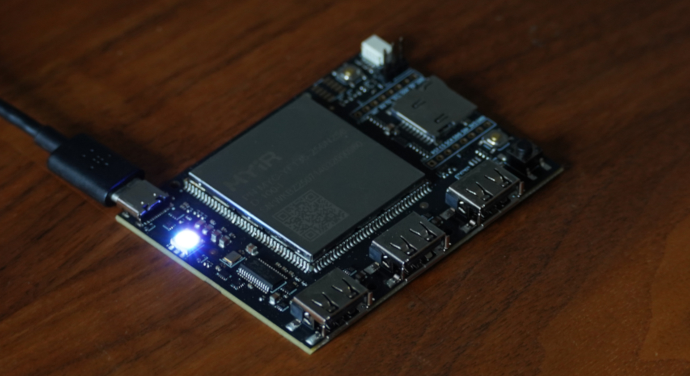
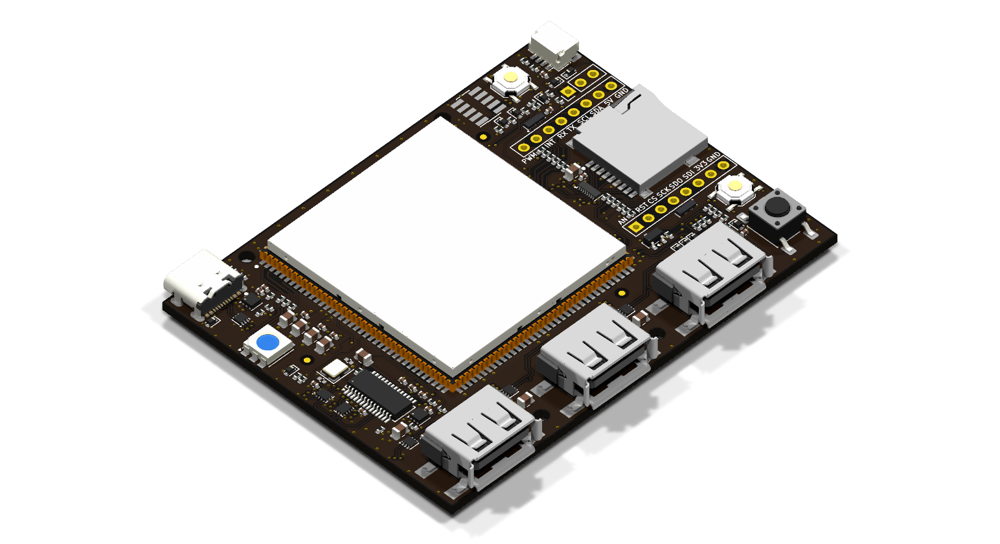

# Deadband Labs Syncro

|||
| :---: | :---: |
|  |  |

A USB HID force-feedback interceptor between a PC and FFB devices, based on the
MYIR MYC-YF135 SOM (STM32MP135) and fully USB bus powered.

The board has three USB-A downstream ports, with a runtime-switched two-position topology mux:

- Mode 1 (default): the PC sees the SOM as a USB gadget; downstream
  ports sit behind the hub on the SOM host port.
- Mode 2: USB-C feeds the hub uplink and downstream ports connect to the PC
  directly, with the SOM as a peer device, for downstream device management.

The board also serves as an STM32MP13 development board, with Qwiic and
mikroBUS (unpopulated) as GPIO expansion, SWD, UART debug header, user buttons
and an RGB status LED.

## Hardware

- STM32MP13, 1GHz Cortex A7, 256MB DDR3L; boots from on-module 256MB SPI NAND,
  USB DFU on SW2, or SDMMC
- USB-C device port (fixed 5.1 kOhm Rd both CC pins, no PD or CC sensing)
- FE1.1s 4-port hub, three downstream ports on horizontal USB-A, each with
  common-mode filter + ESD (ECMF02-2AMX6)
- Input eFuse (647 mA) + reverse blocking on the 5 V rail
- microSD slot (SDMMC1), console UART on a 1x3 0.1" header, SWD on a
  1.27 mm 10-pin
- Qwiic (J9), mikroBUS/Click footprint (J8), reset/DFU/case-user buttons,
  RGB status LED on TIM1
- 4 layer, 1.6 mm, ENIG, JLC04161H-3313; single-sided SMT assembly

## Opening the design

Designed in KiCad 10. Open `syncro-mainboard/syncro-mainboard.kicad_pro` from a
clone of this repository. Libraries use paths relative to the project
(`${KIPRJMOD}/../syncro-pcb-lib/`), so no library setup is needed. Vendor
datasheets, vendor 3D models, fabrication outputs and internal DFT tools are not
included. _As a result, missing-3D-model warnings are expected._ This does not affect
the schematic, layout, DRC or plots.

Part numbers as assembled are in the LCSC fields on the schematic symbols.

## Interfaces

### Qwiic (J9)

JST SH 1.0 mm, 4 pin, horizontal: `GND`, `3V3`, `SDA` (`PH7`) and `SCL` (`PH3`),
both on I2C3 and shared with the mikroBUS socket, with 10 kOhm pull-ups fitted.
Qwiic modules usually also provide pull-ups, so a long chain may over-pull the bus.
Prefer a module without pull-ups or drop bus speed to 100 kHz.

### mikroBUS / Click (J8, DNP)

Standard mikroBUS pinout on two 1x8 sockets at 22.86 mm row spacing. All 12
IO signals route to SOM GPIO, chosen for the roles below:

| Pin | mikroBUS | Board net | SOM pad | SOM port | Roles |
|---:|---|---|---:|---|---|
| 1 | `AN` | `AIO1` | 48 | PA1 | ADC1/2_INP3, TIM2_CH2, TIM5_CH2, TIM15_CH1N |
| 2 | `RST` | `RST` | 92 | PA5 | ADC1_INP2, TIM2_CH1 |
| 3 | `CS` | `SPI_CS` | 80 | PA4 | SPI1, ADC1_INP14, ClickID 1-Wire |
| 4 | `SCK` | `SPI_SCK` | 79 | PC3 | SPI1, I2S1_CK, ADC1_INP13 |
| 5 | `MISO` | `SPI_MISO` | 77 | PA6 | SPI1, ADC1_INP17, TIM3_CH1, TIM13_CH1 |
| 6 | `MOSI` | `SPI_MOSI` | 78 | PA3 | SPI1, I2S1_SDO, ADC1_INP12 |
| 7 | `3V3` | `3V3` | 16 | - | keep under 100 mA, no limit |
| 8 | `GND` | `GND` | - | - | |
| 9 | `PWM` | `AIO0` | 47 | PA2 | ADC1/2_INP1, TIM2_CH3, TIM5_CH3, TIM15_CH1 |
| 10 | `INT` | `INT` | 91 | PF11 | ADC1/2_INP8 |
| 11 | `RX` | `CAN_RX` | 96 | PB5 | FDCAN2, UART5_RX, TIM3_CH2 |
| 12 | `TX` | `CAN_TX` | 95 | PB13 | FDCAN2, UART5_TX, LPTIM2_OUT |
| 13 | `SCL` | `I2C_SCL` | 93 | PH3 | I2C3 |
| 14 | `SDA` | `I2C_SDA` | 94 | PH7 | I2C3 |
| 15 | `5V` | `SYS_5V` | - | - | board 5 V rail |
| 16 | `GND` | `GND` | - | - | |

`AN` and `PWM` use a 330 Ohm series resistor, remaining GPIO 33 Ohm
for protection. All pins share two 0.3 pF ESD arrays. `RX`/`TX`
for UART5 also support FDCAN2 directly, so a CAN transceiver Click should work.

### Console (J2) and SWD (J3)

| J2 pin | Signal |
|---:|---|
| 1 | `GND` |
| 2 | `UART4_TX` |
| 3 | `UART4_RX` |

J3 is a standard ARM Cortex Debug 10-pin, 1.27 mm: pin 1 `VTref` on `VDD_3V3`,
SWDIO/SWCLK plus reset.

### USB

- J1 (USB-C): device port; reaches the SOM in mode 1, hub port 1 in mode 2.
- J5-J7 (USB-A): hub ports 2-4, shells to GND, sharing a VBUS current limit of
  about 250 mA (200-300 mA over tolerance) set by a TPS25200.

### microSD (J4)

SDMMC1 via an EMIF06-MSD02N16, which provides series resistance, filter
capacitance, ESD and card detect on SOM pad 110 (`PD12`). Normally empty, meant
for development or as an alternate boot target using a cut trace on the bottom
of the board.

### Power budget

USB-A's ~250 mA limit leaves about 400 mA for the SOM (measured 128 mA average,
~160 mA peak), the hub (30-80 mA) and everything else, inside the 647 mA nominal
input eFuse limit (590-710 mA over tolerance, 150 kOhm ILIM). A PC USB 2.0 port
generally only guarantees 500 mA, so downstream devices should be self-powered
for best reliability.

GPIO peripherals are powered from the SOM's 3V3 output, shared with the rest of
the board and with no limiting eFuse on these pins. Keep the total under 100 mA
to avoid brownout.

## Software

The board's OS (TF-A, OP-TEE, U-Boot, Linux kernel and rootfs) is built
with the Deadband Labs Buildroot SDK:
<https://github.com/deadbandlabs/dbl-buildroot>. It builds a complete image from
upstream sources that boots the MYIR SOM, with console, USB gadget and host,
SPI NAND and SD card enabled in the device tree.

dbl-buildroot is designed to be extended by a parent project: a device tree
include applied on top of the base tree, plus a `BR2_EXTERNAL` tree adding
packages, overlays and defconfigs, see its
[Parent Integration](https://github.com/deadbandlabs/dbl-buildroot/wiki/7.-Parent-Integration)
page. Carrier board peripherals (USB hub control, Qwiic and I2C, mikroBUS and so
on) are implemented this way. The Syncro userspace and its board layer are
pending final publication and will be linked here when complete.

## Licence

Design files: CERN-OHL-W-2.0, see `LICENSE` and `NOTICE`.

A design using the board only through its external interfaces (USB ports, Qwiic,
mikroBUS/Click, console serial header and SWD) is External Material under
section 1.8 of the licence and does not need to be released. Modified design
files must be published under the same licence.

`syncro-pcb-lib/` is generated from the project's parts library (see
`syncro-pcb-lib/GENERATED.md`), and part of it derives from stock KiCad libraries,
which stay CC-BY-SA-4.0 with the KiCad libraries exception. See `NOTICE`.
